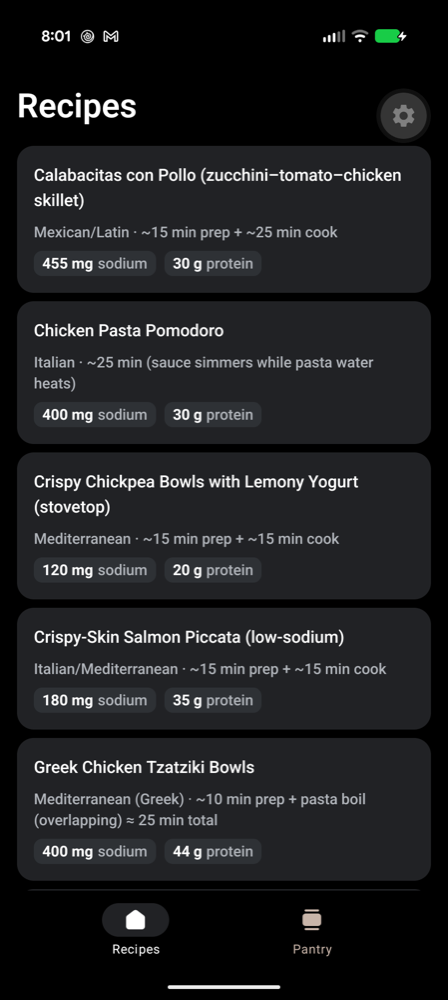
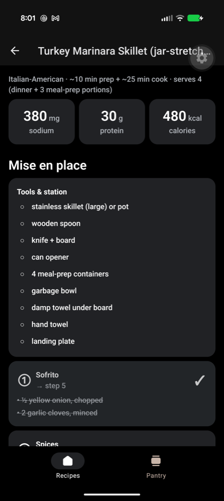
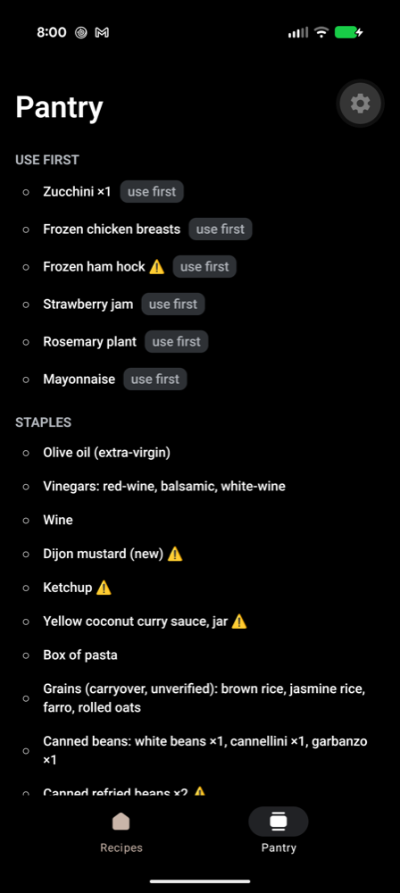

# mise

A React Native cooking companion for the kitchen counter — recipes, mise-en-place
checklists, and a pantry inventory, all sourced from a plain-markdown cooking
workspace and bundled into the app at build time.

<p>
  
  
  
</p>

## What it is

I cook low-sodium and keep my cooking life — recipes, pantry, meal plans — as
markdown files in a local workspace that AI agents help maintain (the
[CLAUDE.md](https://docs.claude.com/en/docs/claude-code/memory) pattern: the
workspace carries its own conventions, and agents read them before touching
anything). This app is that workspace's phone client:

- **Recipes list** — every recipe with sodium/protein badges up front, because
  that's the first question I ask of any dish.
- **Recipe detail** — the hero screen, built around *mise en place*: each prep
  bowl is a checkable card showing its ingredients, amounts, and the step where
  it tips into the pan. Tools checklist, numbered steps with heat-level chips,
  and the screen stays awake while you cook (wet hands don't tap).
- **Pantry** — a sectioned checklist of what's actually in the kitchen.

There is no backend. A build-time script parses the markdown into JSON that
ships inside the app; re-running it refreshes the data. Sync is deliberately
out of scope.

## The interesting parts

**Markdown → JSON pipeline.** Recipes follow a machine-readable template
(circled-digit bowl lines with "→ step N" targets, ALL-CAPS heat tokens inside
bold step lead-ins, first-number-after-marker nutrition). The contract lives
with the data as a comment block in the workspace's template file;
`scripts/parse-recipe.ts` implements it as a pure function, and the exporter
treats parser warnings as build failures — if a recipe drifts from the
contract, the export breaks loudly instead of rendering wrong.

**Privacy by design.** The source workspace is personal; the repo is public.
Three layers keep those separate: the parsers extract an *allowlist* of fields
(nothing outside it can leak by construction), the exporter greps its own
output for marker phrases from the workspace's private sections and refuses to
write if any appear, and the real export is gitignored — a committed sample
dataset plus a postinstall seed keep fresh clones building without access to
the workspace.

**Session-scoped checklists.** Checked bowls survive navigating away mid-cook
(module-level store) but reset when the app restarts — matching how a cooking
session actually works, with zero persistence machinery.

## Stack

Expo SDK 57 · React Native 0.86 · React 19 · TypeScript (strict) · expo-router
(native tabs + a nested native stack per tab) · jest-expo +
@testing-library/react-native v14 · React Compiler enabled.

```
~/cooking/*.md ──▶ scripts/export-data.ts ──▶ assets/data/*.json ──▶ src/data/* ──▶ screens
                   (parse + validate + privacy guard)                (typed modules)
```

## Running it

```bash
npm install        # postinstall seeds assets/data/ from the committed samples
npm start          # Expo dev server (Expo Go or a dev build)
npm test           # 36 tests: parser contract + components + hooks
npm run typecheck && npm run lint
npm run export-data  # only with the private workspace present (COOKING_DIR env to point elsewhere)
```

## What I learned about RN (coming from web React)

Four years of production React/Redux, zero mobile before this. The diffs that
actually mattered:

- **`FlatList`/`SectionList` are not `.map()`.** They virtualize — only visible
  rows mount. `keyExtractor` is the `key` prop promoted into the list API, and
  `contentContainerStyle` vs `style` is the scroll content vs the viewport.
- **`Pressable` replaces CSS pseudo-states.** Its `style` prop takes a function
  of press state — `:active` as data, not selector.
- **`StyleSheet` has no cascade.** Style arrays compose like `classNames()`;
  there's no inheritance to fight, which is mostly a relief.
- **Navigation is native, not rendered.** expo-router's NativeTabs and Stack
  drive real platform navigators — the back gesture and header aren't JS
  reimplementations. Pushing a detail screen means nesting a Stack inside a
  tab, not adding a route to a switch.
- **Testing went async.** RNTL v14 under React 19's concurrent renderer makes
  `render`, `fireEvent`, and `renderHook` promise-returning — every test
  awaits everything.
- **The device is part of the toolchain.** Half of "it doesn't work" lives in
  `adb logcat`, not the JS console — including one memorable segfault that
  turned out to be a broken Expo Go client build, diagnosed from the crash
  buffer's fault address matching an upstream issue.

## Built with agents, on purpose

This repo is also an experiment in agent-paired development: I built it working
with Claude Code, against a markdown workspace that agents co-maintain. Commits
are co-authored accordingly — the history is the honest record of how the
pairing actually went, small buildable steps included.
